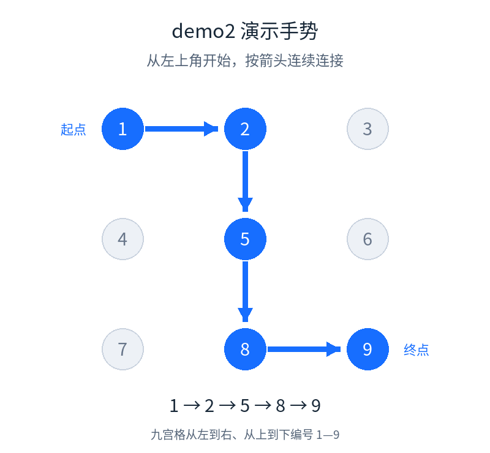
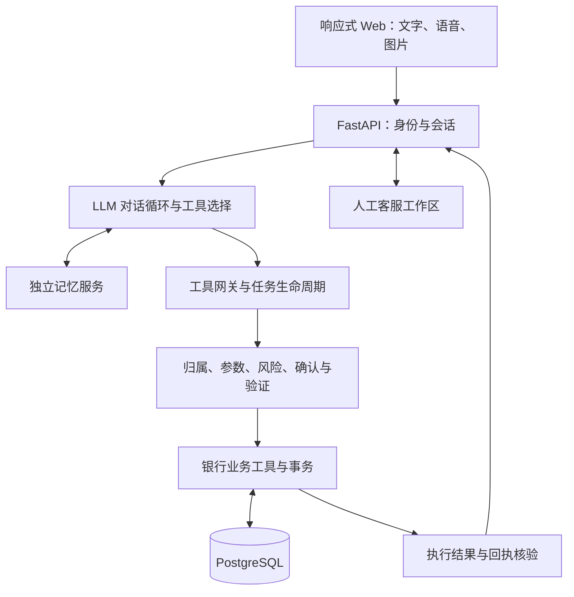

# Banking Agent · 银行 AI 智能体

**用自然语言发起银行业务，让每一次资金操作经过可核对、可确认、可追溯的执行流程。**

Banking Agent 是面向银行 AI 智能体赛题的可交互原型。大模型负责理解需求、追问缺失信息、选择工具和组织答复；服务端负责账户归属、参数校验、风险分级、用户确认、支付验证、事务处理与回执核验。

系统围绕转账、账单、理财、卡片、订阅及跨场景任务六个方向提供能力，并结合多模态输入、用户资料与长期记忆、反诈提醒和人工客服接续。

## 在线体验

### [进入 Banking Agent 在线系统](https://bank.47-238-220-216.sslip.io/ui/)

推荐使用手机或电脑浏览器访问。评委可使用下方 demo2 演示账号，按步骤体验模拟银行业务。

- **直接体验业务：** 使用上述服务器入口，无需在本地安装工程。
- **查看实现：** 本仓库提供前后端源码、依赖配置和部署说明。
- **模拟短信接收：** [演示短信接收箱](https://sms.47-238-220-216.sslip.io/)，输入银行安全中心设置的安全手机号，查看发送到该号码的演示短信，无需独立领取凭据。

账户、交易、理财产品和资金变动均为模拟业务，不连接真实银行或支付清算网络。在线可用性及具体配置以演示时的服务器状态为准。

[体验路线](#建议体验路线) · [业务能力](#六个业务方向) · [项目特色](#项目特色) · [安全设计](#安全如何进入业务流程) · [系统架构](#系统架构) · [部署说明](#部署与开发) · [参赛材料](#参赛材料与验证范围)

### 评委演示账号与支付验证

以下为专用模拟演示账号，不涉及真实银行资金。请保留账号现有验证设置，便于其他评委继续体验。

| 项目 | 演示信息 |
|---|---|
| 登录账号 | `demo2` |
| 登录密码 | `070717` |
| 支付密码 | `547350` |
| 手势顺序 | `1 → 2 → 5 → 8 → 9`，见下图 |
| 安全手机号 | `19900000002` |
| 短信接收箱 | [打开演示短信接收箱](https://sms.47-238-220-216.sslip.io/) |
| 短信验证码 | 每次发送时随机生成，无固定验证码；到接收箱查看最新短信 |



九宫格按从左到右、从上到下编号。按住左上角，依次经过上中、正中、下中，最后到右下角后松开。

1. 打开在线银行，用 `demo2` 和登录密码进入。
2. 发起一笔模拟转账，例如“给黄玲转账 3001 元”，按实际联系人候选选择收款人，并补充付款卡。核对姓名、金额与银行卡后确认。
3. 按独立验证页面输入支付密码并绘制上图手势；系统要求短信时，点击发送验证码。
4. 在另一标签页打开短信接收箱，输入 `19900000002`，查看最新短信。将验证码填回银行验证页面，按提示完成操作。
5. 查看交易回执及账单记录核对结果。验证码过期时返回银行重新发送；发送后有 60 秒重发冷却时间，验证码有效期为 5 分钟。

接收箱按安全手机号展示模拟短信，无需独立领取凭据。验证信息由团队提供；如果账号设置发生变化，应先联系团队核实，避免连续试错。多个评委共用账号时，请错开支付演示，以免最新短信覆盖前一次验证码。

## 建议体验路线

下面是建议的体验顺序。PPT 已保留转账回执、图片账单保存和偏好跨对话回读的演示证据；本次材料修订未重新运行线上流程。具体证据与未验证范围见 [评审核验指南](docs/REVIEW_GUIDE.md)。请使用演示账户中实际存在的联系人、银行卡和资料。

| 步骤 | 操作 | 重点观察 |
|---|---|---|
| 1. 发起转账 | 输入或在支持的浏览器中语音说出“给某位已登记联系人转账 3001 元” | 收款人或出账卡不明确时是否追问，是否先展示业务信息而非直接付款 |
| 2. 核对与验证 | 核对收款人、金额、出账卡，按页面完成确认和支付验证 | 支付密码、手势及演示短信按当前策略触发；模型不能代替本人验证 |
| 3. 核验结果 | 查看执行结果与交易回执 | 是否有可回读的业务记录；不能仅凭一段自然语言认定交易成功 |
| 4. 记忆与资料 | 在已启用记忆的环境中表达偏好，再查询或管理该偏好 | 账户资料、用户偏好与当前任务参数是否各有来源；记忆不能替代本次付款授权 |
| 5. 图片账单 | 上传一张模拟账单，核对识别出的日期、商户与金额 | 识别结果是否可检查和修正，确认后再保存 |
| 6. 人工接续 | 从当前业务进入人工客服流程 | 坐席在线时能否接续处理；无人在线时是否如实提示 |

3001 元用于展示可能触发更强验证的资金操作。具体验证组合还取决于操作类型、账户状态和运行配置，不能把这一金额当作所有业务唯一的风险阈值。演示前需准备并核对本人支付验证信息及已设置的安全手机号。

## 六个业务方向

| 方向 | 当前工程提供的能力 | 主要源码入口 |
|---|---|---|
| 智能转账 | 联系人及收款目标解析、草稿补充与修订、预览、确认、分级验证、执行与回执查询 | [payments](backend/payments/)、[支付对话接口](backend/api/payment_dialogue.py) |
| 账单分析 | 按期间、商户和金额等条件查询与汇总；区分购买消费、资金流出、退款等口径 | [账单服务](backend/bill_service.py)、[分析服务](backend/analysis_service.py) |
| 理财操作 | 模拟产品查询与比较、风险资料、持仓、申购与赎回 | [理财服务](backend/wealth_service.py) |
| 卡片管理 | 本人卡片查询、限额调整、挂失等操作 | [卡片服务](backend/card_service.py) |
| 订阅管理 | 范围授权、有效订阅及费用查询、确认取消与结果恢复 | [订阅服务](backend/subscription_service.py) |
| 跨场景任务 | 工具调用衔接、DAG 校验、依赖执行、暂停与继续、原任务结果核实 | [任务生命周期](backend/lifecycle/)、[执行层](backend/execution/) |

覆盖六个方向不等于完成赛题每个示例。自动订购鲜花蛋糕、任意长期自动执行等不列为当前已交付能力。

## 项目特色

### 大模型参与业务对话

对话循环向模型提供当前问题、必要上下文和可用工具，由模型选择查询、追问或业务工具。真实账户数据通过工具取得，执行权限和资金状态由服务端控制；查询、修改草稿、确认与执行各有明确的业务边界。

实现入口：[对话循环](backend/dialogue/loop.py)、[工具基础层](backend/foundation/)。

### 用户资料与独立长期记忆

账户资料、风险资料与偏好信息服务于不同目的。长期记忆通过独立的 Hindsight 服务接入，提供来源管理及删除等接口；历史偏好可辅助后续交流，但不能授权转账、覆盖当前任务参数或被当作账户余额。

实现入口：[记忆接入](backend/recall_bridge/)、[用户资料界面](frontend/src/components/AccountProfileHub.tsx)。

### 文本、语音与图片入口

支持文本对话、浏览器语音输入和图片账单识别。图片识别结果进入核对流程，用户可修正后保存。

浏览器语音能力受浏览器、麦克风权限和环境影响；工程还提供可配置的录音转写通道，是否可用取决于转写服务配置。不承诺所有微信内置浏览器均可使用语音。

实现入口：[图片账单](backend/billvision/)、[语音接口](backend/api/voice.py)。

### 有依据的反诈提醒

风险提醒结合模型提取的对话线索与程序计算的历史交易统计。模型可报告身份冒充、催促付款、要求保密、刷单返利、远程控制五类线索，服务端核验引用确实来自当前用户原话。

统计范围为当前付款卡最近最多 2000 笔已完成转账，排除当前任务及未来记录。历史至少 8 笔且 MAD 大于零时，以 `max(P95, 中位数 + 6 × MAD)` 判断金额偏离；MAD 为零时采用分位数备用规则。另检查首次收款对象、少见时段及过去 10 分钟的转账频次。样本不足时明确说明限制，不推断没有依据的异常。

提醒记录规则版本、任务修订和证据摘要；任务或证据变化后重新核对。接受或忽略提醒均不会获得支付授权。

提醒展示核实依据，不代表判定交易一定是诈骗；用户查看提醒后的后续操作仍受原确认与支付验证流程约束。该能力是演示性风险提示，不是经过银行生产验证的反欺诈模型。

实现入口：[风险提示](backend/assistance/risk.py)。

### 人工客服接续

用户可以从业务流程进入人工客服。工作台与请求队列由服务器提供，坐席在个人电脑浏览器中通过独立身份登录，个人电脑是操作终端。人工请求与原任务关联，不能替代用户付款确认或验证。PPT 已展示请求保留，当时无人在线；完整的坐席接收与回复仍待验证。

实现入口：[人工接续服务](backend/assistance/service.py)、[坐席界面](frontend/src/components/SeatWorkspace.tsx)。坐席入口：[独立工作台](https://bank.47-238-220-216.sslip.io/ui/?workspace=seat)，需团队另行提供坐席账号，demo2 不能登录坐席。

## 安全如何进入业务流程

安全控制落在服务端的工具、任务、权限和执行边界中，而不只依靠提示词要求模型“谨慎”。

| 控制点 | 实现思路 |
|---|---|
| 身份与资源归属 | 服务端从当前身份确定资源范围，校验账户、任务和操作归属 |
| 分级执行 | 读取类操作在权限和范围满足后执行；状态变更按策略要求确认或更强验证 |
| 支付验证 | 工程提供支付密码、手势、演示短信及 TOTP 相关能力，具体组合以启用的业务路径和配置为准 |
| 草稿与版本 | 将待确认内容与任务版本关联；修改参数后需重新核对，旧授权不能用于替换后的操作 |
| 金融事实核验 | 通过工具结果和回执支撑答复，区分未执行、执行成功、执行失败和结果未知 |
| 不可信输入边界 | 用户文本、图片内容和历史记忆不能直接赋予工具权限或绕过服务端验证 |
| 幂等与恢复 | 结果未知时核实原任务，避免把未知结果当作失败而再次发起资金操作 |
| 审计与异常限制 | 记录关键操作及状态变化，并由相应模块处理验证失败、调用预算和重复无进展等异常 |

上述机制说明实现边界，不代表提示词注入或模型幻觉已被完全消除。模拟短信不证明真实手机号持有权；密码与手势也不能直接等同于生产级多因素认证。

## 系统架构



该图概括主要职责与关系，具体业务以源码调用路径为准。

| 层级 | 技术与职责 |
|---|---|
| 前端 | React、TypeScript、Vite、Tailwind CSS；对话、业务信息、确认验证与坐席界面 |
| 后端 | Python、FastAPI、Pydantic；API、对话循环、工具与业务控制 |
| 数据 | PostgreSQL；账户、业务任务、交易及相关持久状态 |
| AI 与多模态 | 可配置模型接口、图片账单识别、浏览器语音及可配置录音转写 |
| 长期记忆 | Hindsight 独立服务及记忆接入层 |
| 部署 | Docker Compose、Nginx HTTPS；银行、短信、记忆、网关与数据库服务分工 |

## 部署与开发

**评委体验优先使用在线入口。** 自行部署需要准备数据库、受限角色、迁移、合成演示数据、模型及记忆服务和工程外配置。当前部署说明面向已准备的受控环境，尚未提供经过空白主机验证的一键首次安装。

| 任务 | 入口 |
|---|---|
| 服务器部署与运维 | [deploy/server/README.md](deploy/server/README.md) |
| 前端安装与构建 | [frontend/README.md](frontend/README.md) |
| 合成数据初始化说明 | [demo/README.md](demo/README.md) |
| 服务器程序入口 | [tools/server_entry.py](tools/server_entry.py) |
| 本地已有环境入口 | [run_integrated.ps1](run_integrated.ps1)、[run_integrated.bat](run_integrated.bat) |

前端构建命令，在 `frontend` 目录执行：

```bash
npm ci --ignore-scripts --no-audit --no-fund
npm run build
```

后端通过 `/ui/` 提供 `frontend/dist/` 中的页面；Docker 构建也使用该目录。修改前端源码后需要重新构建。

已配置好的本地环境可在工程根目录启动：

```bash
python tools/run_integrated.py
```

该命令不会自动完成首次安装，也不会自动初始化、重置或覆盖已有数据库。

交付文件完整性检查：

```bash
python -B deploy/server/verify_package.py .
```

该命令核对 `MANIFEST.json` 中的文件大小与哈希，不代表业务验收。修改 README 或其他受清单覆盖的文件后，需要同步更新清单。

## 仓库结构

| 路径 | 内容 |
|---|---|
| `backend/` | API、Agent、银行业务、安全控制、任务生命周期、记忆接入及 SQL 迁移 |
| `frontend/` | 前端源码、构建配置、依赖锁与现有页面构建产物 |
| `deploy/server/` | 服务器部署、配置模板、健康检查与运维工具 |
| `deploy/r4/` | 模型网关与固定依赖配置 |
| `tools/` | 当前启动、模拟短信、原生记忆和数据初始化工具 |
| `demo/spec/` | 初始化使用的合成银行数据规格 |
| `manual/` | 票据审核页面 |
| `tests/` | 本次新增的统计反诈单元测试 |
| `docs/` | 评审核验指南、测试复现说明及 README 手势图 |

## 参赛材料与验证范围

作品简介、技术文档、安全自评、PPT 和视频以大赛系统提交版本为准；本仓库不包含这些成品的副本。评审核验入口见 [docs/REVIEW_GUIDE.md](docs/REVIEW_GUIDE.md)。PPT 内嵌截图可用于查看所展示案例，但原始录屏、完整日志和 PPT 生成工程未打包进源码。

当前材料对齐修订为 `submission-aligned-20261102-r1`，沿用 `final5-memoryfix1-slim-20261102` 的业务源码基础。此次新增测试和评审说明，未修改业务运行代码、SQL 迁移及前端产物。旧整理记录保留在 [SOURCE_PACKAGE.json](SOURCE_PACKAGE.json)，本次身份与范围见 [SUBMISSION_VERSION.json](SUBMISSION_VERSION.json)。`SERVER_VERSION.json` 是随包保留的历史部署记录，不是服务器实时状态。

PPT 展示的 `e0c62a55524a…` 为原取证时运行标识。当前源码已包含手机号短信接收实现；是否已加载到服务器，需另行核对部署记录和实际流程，不能由源码 ZIP 推断。

### 当前可执行测试

在仓库根目录运行：

```bash
python -B -m unittest discover -s tests -v
python -B deploy/server/verify_package.py .
```

统计反诈测试本轮 **17/17 通过**，不需要数据库或模型。测试从实际源码提取 `statistics` 纯函数，验证样本门槛、金额阈值、MAD 为零、首次收款人、时段和频次等边界。它不加载数据库编排，不验证对话模型、支付授权、短信 HTTP 或端到端交易，也不是诈骗识别准确率。环境要求、用例与结果见 [docs/TESTING.md](docs/TESTING.md)。

完整业务回归、真机语音、坐席接收与回复、空白主机首次部署仍未完成同版本验收。旧测试集和历史日志不重新纳入交付。

## 演示边界

- 银行业务和资金为模拟数据；产品信息不构成真实投资建议。
- 当前主要交互渠道为响应式 Web，不将其描述为已接入原生 App 或真实 IM 平台。
- OCR、记忆、语音转写和人工客服体验依赖相应服务、配置及在线状态。
- 风险提醒、模型答复和历史记忆均不能替代用户授权与服务端金融执行控制。
- 本项目不宣称达到生产银行的认证、高可用、容灾或合规验收标准。

除本页明确提供的专用模拟演示账号信息外，私密配置、API 密钥、真实支付凭据、数据库备份及实际会话记录不应提交到公开仓库。
